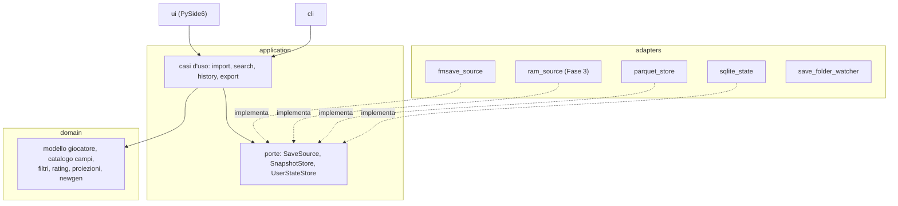

# FM X-Ray — Spec madre (prodotto e architettura)

> Output del brainstorming dal 2026-10-31 al 2026-11-03. Questa è la **spec madre**: fissa perimetro, stack, confini, modello dei dati e ordine dei sottoprogetti. Ogni sottoprogetto avrà poi la sua spec di dettaglio → piano → implementazione.

## Context

Gli scouting tool per Football Manager che mostrano i dati nascosti (Genie Scout, FMSuperScout, FM26-Analyst) sono closed source o solo Windows, e leggono la memoria del gioco legandosi a build precise. La web app di fmsave legge i save ma non tiene storico, non ha pesi modificabili né proiezioni. L'utente vuole **un tool suo**, senza dipendere da quelli esterni.

**Obiettivo:** un'app desktop per Linux e Windows, da tenere sul secondo schermo mentre FM gira sul primo. Legge i save di FM27 (e FM26 nei limiti di fmsave) e mostra tutto il database dei giocatori con più dati possibili, compresi CA, PA e hidden. Si aggiorna da sola quando il gioco salva e tiene uno storico tra i save.

**Cosa ha deciso l'utente durante il brainstorming:**
- fonte dati fmsave con versione bloccata, dietro un solo adattatore; niente parser del save scritto da noi;
- lettura dalla RAM solo alla fine, come seconda fonte, per Windows e Linux via Proton;
- ~~FM26 prima di FM27~~ → **FM27 obiettivo principale** (aggiornato il 2026-11-03: l'utente gioca solo a FM27);
- app desktop PySide6 + Qt Widgets, niente "aspetto da sito";
- logica separata dalla UI;
- tutte le raccomandazioni della sessione del 2026-11-03: storico sfoltito, Parquet + Polars + SQLite, pesi in TOML, test su tre livelli, uv/Ruff/mypy, architettura esagonale, ordine dei sottoprogetti.

**Assunzioni:** sviluppatore singolo con Claude; uso personale; database fino a ~600k giocatori; l'utente fornisce save reali e verifica i valori nel gioco.

Contesto esterno raccolto: [wiki/reference/fmsave.md](../../../wiki/reference/fmsave.md), [wiki/reference/prior-art.md](../../../wiki/reference/prior-art.md).

---

## 1. Perimetro

**Obiettivi**
- Ricerca con filtri combinabili su qualunque campo, compresi CA, PA e hidden (es. età < 22 **e** PA > 180).
- Tabella ordinabile su tutto il database, scheda giocatore, export CSV.
- Aggiornamento automatico quando FM salva; storico tra i save; rilevamento dei newgen.
- Fase 2: rating per ruolo con pesi trasparenti e modificabili, proiezione degli attributi, rating futuro, asking price stimato.

**Non obiettivi**
- Modificare save o memoria del gioco; overlay dentro FM.
- Carriere online condivise.
- Attributi dello staff, nomi di competizioni e nazioni presi dal database installato del gioco (non sono nel save: eventualmente mappe fornite dall'utente).

**Anti-obiettivi (sarebbe un fallimento anche se funzionasse)**
- Un valore stimato mostrato come se fosse letto dal gioco.
- Un campo "non confermato" da fmsave mostrato come certo.
- Dati di SI/SEGA nel repository, nelle issue o nella wiki.
- Rating calcolati con coefficienti nascosti che l'utente non vede (il difetto contestato a Genie Scout).
- Un'interfaccia che sembra un sito web.

## 2. Fonte dati

- **fmsave**, versione **esatta** bloccata nel lock di uv; si aggiorna solo con una decisione esplicita dopo aver letto il changelog (26 release in 6 settimane).
- **Un solo modulo importa fmsave:** `fmxray.adapters.fmsave_source`. Traduce i record di fmsave nel nostro modello. Nessun tipo di fmsave esce da lì.
- **Lettura sicura:** si legge sempre una **copia** del save (fmsave lo raccomanda col gioco aperto).
- **Stato dei campi:** per ogni campo usato l'adattatore registra lo stato `verified`/`unconfirmed` (`fmsave.field_status`) nel catalogo dei campi (sezione 4).
- **Contributi a fmsave** solo come issue, con prova verificata nel gioco, senza allegare save.
- **FM27 è l'obiettivo principale.** Build di riferimento: quella del save dell'utente, `27.0.0+2493426` (non registrata in fmsave 0.9.3, che usa i layout della `2486695`). Tutti i campi FM27 sono `unconfirmed` finché non li verifichiamo nel gioco. FM26 resta supportato nei limiti di fmsave.

**Verifiche da fare in SP1 su un save reale** (decidono dettagli di SP1 e SP2):

| ID | Domanda |
| --- | --- |
| V1 | Quali dei 13 hidden sono presenti e con che stato (`dirtiness`, `consistency`, `important_matches`, `injury_proneness`, `versatility` + gli 8 di `personality`) |
| V2 | Come si presentano le clausole rescissorie in `contract.clauses` (valori di `ClauseKind`) |
| V3 | Tempo e memoria di lettura di `players()` su un save grande; dimensione di uno snapshot Parquet |
| V4 | Fattore di conversione dell'unità monetaria interna verso la valuta mostrata |
| V5 | `uid` è stabile tra save successivi della **stessa** carriera? |
| V6 | Il save espone la data di gioco corrente? (serve allo sfoltimento dello storico) |
| V7 | Come appare un newgen: `unique_id` nuovo, `None`, o altro |

## 3. Architettura

**Esagonale (porte e adattatori)**, un solo processo Python.

**Layout del pacchetto** (`src/fmxray/`):

| Pacchetto | Contenuto | Può importare |
| --- | --- | --- |
| `domain` | modello, catalogo campi, filtri, rating, proiezioni, rilevatori newgen | solo stdlib e Polars |
| `application` | casi d'uso e porte (`typing.Protocol`) | `domain` |
| `adapters.*` | fmsave, Parquet, SQLite, watcher della cartella, più avanti RAM | `application`, `domain`, la propria libreria esterna |
| `ui` | finestre, modelli Qt, worker | `application`, `domain`, PySide6 |
| `cli` | comandi da terminale (`fmxray import`, …) | `application` |
| `bootstrap` | composition root: costruisce adattatori e casi d'uso | tutto |

`__main__` e gli entrypoint contengono solo la chiamata a `bootstrap`: **nessuna logica**. Le regole di import della tabella sono **verificate in CI** (import-linter o equivalente, da scegliere in SP1).

**Pattern, solo dove ripagano:**
- **Strategy:** formule di rating, modelli di proiezione, stimatori di asking price, rilevatori di newgen.
- **Repository:** `SnapshotStore`, `UserStateStore`.
- **Specification/Composite:** filtri combinabili, compilati in espressioni Polars. La barra di ricerca a testo è un parser che produce gli stessi oggetti.
- **Observer:** segnali Qt per la catena "nuovo save → import → aggiornamento della UI".

## 4. Modello dei dati

- **Snapshot:** una lettura di un save. Metadati: carriera, data di gioco (se disponibile, V6), data di lettura, SHA-256 del file, versione di fmsave, build del gioco, sorgente (`fmsave` / `ram`). Immutabile.
- **Righe giocatore:** una per giocatore per snapshot, colonne piatte (identità, club, ruoli, 52 attributi in scala **raw 1–100** più quella 1–20, personalità, CA/PA, reputazione, valore, contratto, tratti).
- **Identità:**
  - `uid` per i join dentro uno snapshot (e dentro una carriera, se V5 lo conferma);
  - `unique_id` per abbinare persone tra carriere; può essere `None`;
  - le persone create in partita possono riusare ID di persone cancellate: il confronto tra snapshot controlla anche data di nascita e nome.
- **Catalogo dei campi** (nel dominio): per ogni colonna nome, tipo, gruppo, unità e **provenienza**: `verified`, `unconfirmed` (da fmsave), `derived` (calcolato da noi) o `estimate` (stima). La UI usa la provenienza per i segni di affidabilità.
- **Soldi:** si conserva il valore nell'unità interna; la conversione è un fattore di configurazione calibrato con V4. Mai salvare valori già convertiti.

## 5. Storage

- **Snapshot:** un file **Parquet** per snapshot (compressione zstd), letto con **Polars**. Lo snapshot corrente sta in memoria come DataFrame.
- **Stato dell'utente** in **SQLite** (`sqlite3` della stdlib): carriere, catalogo degli snapshot, ricerche salvate, watchlist, impostazioni.
- **Cartella dei dati** dell'utente, mai nel repo: posizione standard per sistema operativo (da fissare in SP1, es. via `QStandardPaths` o `platformdirs`).
- **Cache:** se lo SHA-256 di un save è già nel catalogo, non si rilegge.
- **Sfoltimento dello storico** (regole modificabili, con questi default):
  - tutti gli snapshot degli ultimi 30 giorni di gioco;
  - poi uno per mese di gioco;
  - poi uno per stagione;
  - il **primo** snapshot di ogni carriera non si cancella mai (base per i newgen).
- **Più avanti, se serve:** DuckDB può interrogare gli stessi Parquet senza migrazioni; salvataggio delle sole differenze se V3 dice che lo spazio non basta.

## 6. Import e aggiornamento automatico

- L'utente associa una **carriera** alla cartella dei save (o a un file).
- Un watcher (`QFileSystemWatcher` o equivalente) vede i nuovi save; aspetta che la dimensione del file sia stabile, poi copia e importa **in un thread separato**.
- Import idempotente (hash), con errori mostrati senza bloccare la UI; un save illeggibile non rompe lo snapshot precedente.
- Lo stesso caso d'uso è disponibile da terminale: `fmxray import <save>`.

## 7. Ricerca

- Filtri come albero di Specification (`And`, `Or`, `Not`, confronti, intervalli, appartenenza, testo), serializzabili in JSON per le ricerche salvate.
- Compilazione in espressioni Polars; obiettivo: risposta percepita come immediata su 600k righe (soglia esatta in SP2 dopo V3).
- Barra di ricerca a testo (es. `age<22 pa>180 pos:DC`): parser scritto da noi, grammatica definita in SP2.
- Ricerche salvate con nome e conteggio dei **nuovi** risultati dall'ultimo snapshot.
- Export CSV di quello che si vede o di tutto.

## 8. Interfaccia

- **PySide6 + Qt Widgets**, finestra pensata per il secondo schermo.
- Tabella su `QAbstractTableModel` sopra il DataFrame: ordinamento e filtri li fa Polars, la vista disegna solo le righe visibili.
- Scheda giocatore con tutti i campi, raggruppati come nel catalogo.
- Segni di affidabilità: `unconfirmed` e `estimate` hanno uno stile riconoscibile e un tooltip.
- Copia del nome con un click (per incollarlo nella ricerca di FM).
- Interfaccia in **inglese** (decisione dell'utente), testi tutti passati da `tr()` per poterli tradurre.
- **Mockup, tema e layout si decidono all'inizio di SP3**, con il visual companion.

## 9. Fase 2 (dettagli nelle spec di SP4–SP7)

- **Storico e newgen:** crescita della CA, progress rate, watchlist con grafici. Newgen = persona assente nel primo snapshot della carriera; opzionalmente un save del giorno 1 dello stesso database come base.
- **Rating per ruolo:** media pesata normalizzata, **pesi tutti visibili**, profili in **TOML** (letti con `tomllib`, scritti dall'editor con `tomlkit` per non perdere i commenti). Valori di partenza derivati dai test di FM-Arena e dai pesi della CA dell'editor ufficiale di FM27. Valutare l'import dei `.grf` di Genie Scout.
- **Proiezioni:** scalare gli attributi verso la PA preservando il profilo, correggere per età e tipo, limite 20; marcate `estimate`; **verificate a posteriori** confrontandole con gli snapshot successivi.
- **Asking price:** stima marcata `estimate`, opzionale.

## 10. Fase 3 (spec dedicata in SP9)

- Plugin C# BepInEx 6 IL2CPP che **legge soltanto** e passa i dati alla nostra app tramite file o porta TCP locale (funzionano anche attraverso Proton; le named pipe no).
- Nuovo adattatore `ram_source` che implementa la stessa porta `SaveSource`: il resto dell'app non cambia.
- Niente codice copiato da progetti senza licenza o copyleft (fm26rte, FM26-Analyst; FMSuperScout finché la licenza non è chiara).

## 11. Strumenti, test, CI, distribuzione

- **uv** (progetto, lock, `uv run`); **Python 3.13** se PySide6, Polars e fmsave lo supportano, altrimenti 3.12 (verifica in SP1).
- **Ruff** (lint e formato), **mypy strict**, **pytest**, **pytest-qt**, **Hypothesis**.
- **Test su tre livelli:**
  1. dominio e applicazione su dati sintetici generati da factory nostre (gira ovunque);
  2. adattatore fmsave con oggetti finti che imitano i suoi record;
  3. integrazione su save veri in `local/` (escluso da git), saltati se il save non c'è.
- **Repository pubblico su GitHub, licenza MIT** (decisione dell'utente).
- **CI su GitHub Actions** con Linux e Windows: lint, tipi, regole di import, test, e un controllo che fallisce se un `*.fm` è tracciato.
- **Distribuzione:** dal sorgente con `uv run fmxray` fino a SP8, poi eseguibili con PyInstaller (Windows costruito su Windows).
- Codice e identificatori in inglese; documentazione in italiano.

## 12. Sottoprogetti, in ordine (ognuno: spec → piano → implementazione)

1. **Fondamenta:** progetto uv, strumenti, CI, layout dei pacchetti con regole di import, catalogo dei campi, adattatore fmsave, snapshot Parquet, catalogo SQLite, `fmxray import`; verifiche V1–V7.
2. **Motore di ricerca:** Specification → Polars, ordinamento, ricerche salvate, barra a testo, export CSV. Senza UI.
3. **Interfaccia della Fase 1:** mockup, finestra principale, tabella, pannello filtri, scheda giocatore, segni di affidabilità, aggiornamento automatico.
4. **Storico e newgen:** sfoltimento, crescita, progress rate, newgen, watchlist.
5. **Rating per ruolo:** profili TOML, valori di partenza, editor.
6. **Proiezioni e rating futuro.**
7. **Asking price stimato** (opzionale).
8. **Eseguibili** per Windows e Linux.
9. **Fase 3:** lettura dalla RAM.

## Idee per dopo

Confronto fino a 3 giocatori; vista della propria rosa con i buchi per ruolo; export della shortlist nel formato importabile da FM (formato da verificare); mappe `database_id → nome` per competizioni e nazioni; tema chiaro/scuro.

## Da verificare nella spec di ciascun sottoprogetto (documentazione, niente API indovinate)

Versioni correnti di fmsave, PySide6, Polars; supporto Python 3.13; API `field_status` e valori di `ClauseKind`; strumento per le regole di import; posizione standard della cartella dati; comportamento di `QFileSystemWatcher` su Windows e Linux con file scritti a pezzi; formato `.grf`; BepInEx 6 sotto Proton per FM27.

---

## Processo di lavoro

- **Spec madre:** questo file. Le decisioni che cambiano si aggiornano qui e in [wiki/project/decisions.md](../../../wiki/project/decisions.md).
- **Spec e piani dei sottoprogetti:** `docs/superpowers/specs/AAAA-MM-GG-spN-<nome>-design.md` e `docs/superpowers/plans/AAAA-MM-GG-spN-<nome>.md`, scritti **just-in-time** quando il precedente è chiuso.
- **Esecuzione:** skill superpowers inline, senza sotto-agenti: `writing-plans` → `executing-plans` con `test-driven-development` e `verification-before-completion`.
- **Wiki:** si aggiorna (con `wiki/log.md`) alla fine di ogni sottoprogetto.
- **Commit, push e installazioni:** li fa l'utente; Claude propone comandi e messaggi.

## Verifica

- **Della spec:** rilettura per segnaposto, contraddizioni, perimetro e ambiguità (fatta); poi la revisione dell'utente.
- **Di ogni sottoprogetto:** criteri "fatto quando…" nel suo piano, verificati eseguendo test e app.
- **Accettazione della Fase 1 (fine di SP3):**
  1. con un save reale dell'utente, l'app mostra tutti i giocatori entro il tempo fissato dopo V3, su Linux e su Windows;
  2. il filtro età < 22 e PA > 180 restituisce gli stessi giocatori di una query equivalente fatta direttamente con fmsave;
  3. quando FM salva, la tabella si aggiorna senza azioni dell'utente;
  4. i campi `unconfirmed` ed `estimate` sono riconoscibili nella UI;
  5. la CI è verde su Linux e Windows e nessun file di gioco è tracciato.

## Scelte fatte da Claude (da controllare)

- Default dello sfoltimento (30 giorni di gioco / mese / stagione, primo snapshot intoccabile).
- Attributi salvati in entrambe le scale, raw 1–100 e 1–20.
- Carriera associata a una cartella o a un file scelto dall'utente.
- Verifiche aggiuntive V5–V7.
- Criteri di accettazione della Fase 1.
