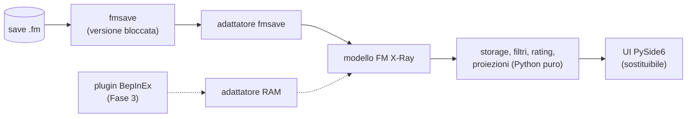

# Architettura

Nessun codice ancora: questa pagina riporta solo i vincoli già decisi. Storage e
distribuzione sono aperti (vedi "Ancora da decidere" in
[decisioni](../project/decisions.md)).

## Vincoli già decisi

- **Fonte dati sostituibile:** un solo modulo adattatore parla con fmsave e
  produce il nostro modello; il resto del tool non conosce fmsave (D3).
- **Seconda fonte futura:** la lettura dalla RAM (Fase 3) dovrà produrre lo
  stesso modello attraverso la stessa porta (D6).
- **Sola lettura, nessuna rete** (D1).
- **App desktop PySide6 + Qt Widgets** (D10); la logica non importa Qt e la UI
  è uno strato sostituibile (D11).

