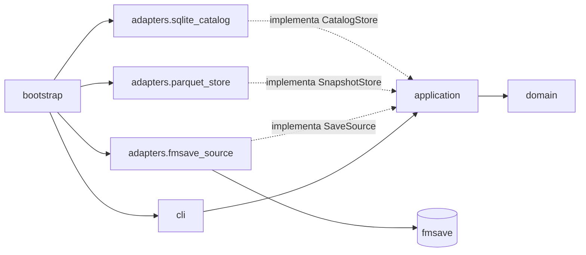

# Architettura

Esagonale (porte e adattatori), un processo Python. Regole di import verificate da `uv run lint-imports` (5 contratti in `pyproject.toml`).

| Contratto | Regola |
| --- | --- |
| 1 | `domain` non importa altri pacchetti del progetto |
| 2 | `application` importa solo `domain` |
| 3 | `cli` non importa adattatori né `bootstrap` |
| 4 | solo `adapters.fmsave_source` importa `fmsave` |
| 5 | gli adattatori sono indipendenti tra loro |

UI PySide6 (SP3) e lettura dalla RAM (SP9) si aggiungeranno come nuovi strati/adattatori senza toccare `domain` e `application` (D10, D11, D6). Moduli: [indice](../modules/README.md).
