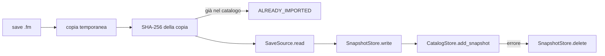

# Modulo application

## Purpose
Casi d'uso e porte (`typing.Protocol`). Dipende solo da `domain` (contratto 2).

## Public interface
| Nome | Ruolo |
| --- | --- |
| `SaveReading` | quello che una sorgente restituisce: metadati del save, provenienze, DataFrame |
| `SaveSource`, `SnapshotStore`, `CatalogStore` | porte implementate dagli adattatori |
| `ImportSave.execute(save_path, career_name) -> ImportResult` | importa un save (`IMPORTED` / `ALREADY_IMPORTED`) |
| `ShowPlayer.find(...)`, `ShowPlayer.details(...)` | ricerca per nome senza maiuscole e accenti; tutti i campi di un giocatore |
| `FmxrayError` e sottoclassi | errori mostrati all'utente |

## Data/control flow

## Invariants
- Hash e lettura si fanno sulla **copia**, mai sull'originale (il gioco può riscriverlo).
- Se il catalogo fallisce dopo la scrittura, il file dello snapshot viene cancellato.
- `ShowPlayer.find` ignora i record senza nome (fmsave ne lascia alcuni incompleti).

## Verification
`uv run pytest tests/application`
