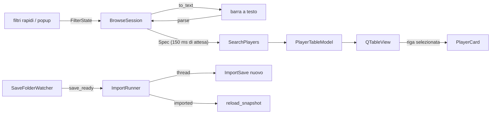

# Modulo ui (interfaccia desktop)

## Purpose
Finestra PySide6 (Qt Widgets) da tenere sul secondo schermo (SP3). `ui` contiene solo widget, modello Qt, watcher e worker: la logica (stato dei filtri, sessione, viste) sta in `application` ed è testata senza Qt. Avvio: `uv run fmxray-gui` (`bootstrap.gui_main` → `ui.run.run_gui`).

## Public interface
| File | Nome | Ruolo |
| --- | --- | --- |
| `main_window.py` | `MainWindow(app, session)` | barra carriera/snapshot, filtri rapidi, barra a testo, ricerche salvate e viste, tabella, scheda; `refresh()`, `reload_snapshot()`, `follow_folder()` |
| `quick_filters.py` | `QuickFilters` | età, CA, PA, posizioni, nome o club; pulsante "All filters… (N active)" |
| `filters_dialog.py` | `FiltersDialog` | popup non modale, una scheda per `FILTER_TABS`, un controllo per ogni campo |
| `range_slider.py` | `RangeControl` | min–max: spin box sulle scale fisse (1–20, 1–100, 1–200), caselle di testo altrove; gli estremi = nessun filtro |
| `pitch.py` | `PitchWidget` | 15 posizioni; selezione con livello (natural ≥18, accomplished ≥15, soglia scelta) o voti in sola lettura |
| `player_card.py` | `PlayerCard` | testata con "Copy name", schede Attributes / Hidden / Contract / Positions |
| `table_model.py` | `PlayerTableModel` | `QAbstractTableModel` su un `SearchResult`; `sort()` chiede l'ordinamento a Polars (`sort_requested`) |
| `watcher.py` | `SaveFolderWatcher` | segnale `save_ready(Path)` quando un `.fm` resta uguale per `STABLE_FOR_MS = 3000` |
| `import_worker.py` | `ImportRunner` | import su `QThreadPool`; segnali `imported`, `failed`; un import alla volta, l'ultimo in coda vince |
| `theme.py` | `TOKENS`, `stylesheet()`, `attribute_band()` | tutti i colori e le misure: SP3b cambia solo questo file |

In `application`: `FilterState` ↔ `Spec` (`to_spec`, `from_spec`), `FILTER_TABS` e `control_kind`, `BUILTIN_VIEWS` (compresa "Hidden by FM"), `BrowseSession`, `default_save_folders`.

## Data/control flow

## Invariants
- Barra a testo e controlli mostrano lo stesso filtro: `from_spec(to_spec(s)) == s` e `parse(to_text(spec)) == spec` (Hypothesis). Un testo che i controlli non sanno mostrare (es. `or` tra campi diversi) diventa `session.advanced` e blocca i controlli; un testo che non si legge mostra l'errore e lascia tabella e filtro com'erano.
- Ogni campo di `SEARCH_SCHEMA` ha un controllo nel popup (`test_every_field_is_filterable`).
- L'import gira in un altro thread con un `ImportSave` creato **lì** (`App.import_factory`): le connessioni SQLite non passano tra thread.
- Dopo un import filtri, ordinamento e selezione restano; se il giocatore selezionato non c'è più, la scheda si svuota.
- Il watcher non riporta i save già presenti quando parte, né la stessa versione due volte.
- `ui` non importa adattatori né `bootstrap`; `domain` e `application` non importano Qt (contratti import-linter).

## Verification
`uv run pytest tests/ui tests/application/test_session.py tests/application/test_filters.py`; sul save reale `tests/integration/test_real_save.py::test_gui_loads_real_save`. Misure sul save reale (126.427 giocatori): apertura ~1 s, filtro 13–100 ms.
