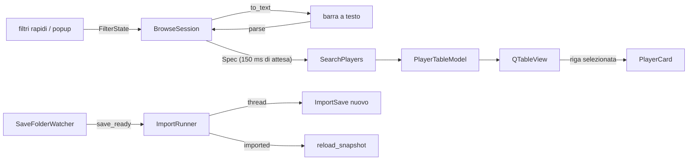

# Modulo ui (interfaccia desktop)

## Purpose
Finestra PySide6 (Qt Widgets) da tenere sul secondo schermo (SP3). `ui` contiene solo widget, modello Qt, watcher e worker: la logica (stato dei filtri, sessione, viste) sta in `application` ed è testata senza Qt. Avvio: `uv run fmxray-gui` (`bootstrap.gui_main` → `ui.run.run_gui`).

## Public interface
| File | Nome | Ruolo |
| --- | --- | --- |
| `main_window.py` | `MainWindow(app, session, settings)` | due righe sopra la tabella (carriera; filtri con chip), barra a testo a richiesta (`Ctrl+K`), barra laterale, linguette delle viste, tabella, scheda; `refresh()`, `reload_snapshot()`, `follow_folder()`, `show_text_bar()` |
| `filter_chips.py` | `FilterChips` | filtri attivi come chip rimovibili; chip "Advanced filter" per il testo non rappresentabile |
| `view_tabs.py` | `ViewTabs` | viste di colonne come linguette, `+` salva la vista corrente, linguetta "Custom" |
| `saved_sidebar.py` | `SavedSidebar(overlay_parent)`, `SavedEntry` | striscia fissa con stella e totale dei nuovi; la lista si apre in un pannello sovrapposto alla tabella (anima la `geometry`, non ridispone il layout) |
| `settings.py` | `UiSettings` | densità e barra laterale ricordate (`QSettings`) |
| `icons.py` | `icon()`, `ICONS` | icone Phosphor via QtAwesome, colorate dai token |
| `motion.py` | `grow_in`, `fade_in` | animazioni brevi (`ANIMATION_MS = 150`); l'hover dei pulsanti è `:hover` nel foglio di stile |
| `quick_filters.py` | `QuickFilters` | età (min–max), "CA ≥", "PA ≥" (solo minimo, `MIN_ONLY_FIELDS`), posizioni, nome o club; pulsante "All filters · N" |
| `filters_dialog.py` | `FiltersDialog` | popup non modale, una scheda per `FILTER_TABS`, un controllo per ogni campo |
| `range_slider.py` | `RangeControl(field, min_only=False)` | min–max (o solo min): spin box sulle scale fisse (1–20, 1–100, 1–200), caselle di testo altrove; gli estremi = nessun filtro, il minimo mostra "min" |
| `pitch.py` | `PitchWidget`, `PLACES` | 15 posizioni; selezione con livello (natural ≥18, accomplished ≥15, soglia scelta) o voti in sola lettura |
| `player_card.py` | `PlayerCard(qml=CARD_QML)` | `QQuickWidget` che carica `ui/qml/PlayerCard.qml`; stessa interfaccia di prima (`show_player`, `clear`, `copy_name`); se il QML non carica mostra l'errore |
| `card_model.py` | `CardModel`, `TABS`, `summary_line` | proprietà Qt lette dal QML: testata, CA/PA e frazioni per la barra di crescita, `areas` (esagono, da `domain.profile`), `tabs`, `positions`, `unconfirmed`; slot `copyName` |
| `qml/` | `PlayerCard.qml`, `Hexagon.qml`, `FieldGrid.qml`, `MiniPitch.qml` | scheda disegnata sulla GPU: iniziali, CA/PA che scorrono, barra CA→PA, esagono che si trasforma (`CARD_ANIMATION_MS = 250`), griglia attributi, campo; colori solo dal contesto `theme` (= `TOKENS`) |
| `table_delegate.py` | `AttributeDelegate`, `pill_colors()` | attributi 1–20 come pillole tinte della banda |
| `table_model.py` | `PlayerTableModel`, `format_money()`, `PILL_ROLE` | `QAbstractTableModel` su un `SearchResult`; `sort()` chiede l'ordinamento a Polars (`sort_requested`); soldi compatti (`4.2M`) con il valore pieno nel tooltip |
| `watcher.py` | `SaveFolderWatcher` | segnale `save_ready(Path)` quando un `.fm` resta uguale per `STABLE_FOR_MS = 3000` |
| `import_worker.py` | `ImportRunner` | import su `QThreadPool`; segnali `imported`, `failed`; un import alla volta, l'ultimo in coda vince |
| `theme.py` | `TOKENS`, `stylesheet()`, `attribute_band()`, `Density`, `row_height()`, `load_fonts()` | tutti i colori e le misure (fondo nero `#0e0f12`, pannelli `#16181d`, accento `#3ea6ff`, scelti il 2026-11-08); font Inter 11pt e JetBrains Mono inclusi in `ui/fonts/` (OFL); `QFrame#panel` per i pannelli arrotondati |

In `application`: `FilterState` ↔ `Spec` (`to_spec`, `from_spec`), `FILTER_TABS` e `control_kind`, `BUILTIN_VIEWS` (compresa "Hidden by FM"), `BrowseSession`, `default_save_folders`.

## Data/control flow

## Invariants
- Colori solo in `theme.py` (`grep` di `#rrggbb` fuori da `theme.py` vuoto, file QML compresi: ricevono `theme`). Nella scheda QML niente `MultiEffect`: non si disegna senza GPU, le ombre sono rettangoli traslucidi.
- Nomi dei campi e valori enum (`contract_squad_status`, `traits`) mostrati con `domain.text.humanize` in stile FM ("Off the Ball", "Regular Starter"); i valori grezzi restano nei dati e nei filtri. I valori accanto a un'etichetta grigia sono azzurri (`value`, `band_3` = `#a8d4ff`).
- Le colonne della tabella si adattano al contenuto e lo spazio in più si divide in proporzione (`_spread_columns`, a ogni ridimensionamento). Su FM27 ogni campo è "unconfirmed": invece di un `ⓘ` per colonna c'è una sola nota nella riga di stato.
- Barra a testo e controlli mostrano lo stesso filtro: `from_spec(to_spec(s)) == s` e `parse(to_text(spec)) == spec` (Hypothesis). Un testo che i controlli non sanno mostrare (es. `or` tra campi diversi) diventa `session.advanced` e blocca i controlli; un testo che non si legge mostra l'errore e lascia tabella e filtro com'erano.
- Ogni campo di `SEARCH_SCHEMA` ha un controllo nel popup (`test_every_field_is_filterable`).
- L'import gira in un altro thread con un `ImportSave` creato **lì** (`App.import_factory`): le connessioni SQLite non passano tra thread.
- Dopo un import filtri, ordinamento e selezione restano; se il giocatore selezionato non c'è più, la scheda si svuota.
- Il watcher non riporta i save già presenti quando parte, né la stessa versione due volte.
- `ui` non importa adattatori né `bootstrap`; `domain` e `application` non importano Qt (contratti import-linter).

## Verification
`uv run pytest tests/ui tests/application/test_session.py tests/application/test_filters.py`; sul save reale `tests/integration/test_real_save.py::test_gui_loads_real_save`. Misure sul save reale (126.427 giocatori): apertura ~1 s, filtro 13–100 ms.
