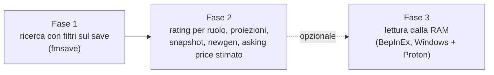

# Roadmap

Tre fasi, in quest'ordine. La suddivisione in sottoprogetti (SP1, SP2, …) verrà
fissata nella spec madre; ogni SP seguirà spec → piano → implementazione.

| Fase | Contenuto | Requisiti |
| --- | --- | --- |
| 1 | Lettura del save, filtri, tabella, scheda, CSV; verifiche iniziali su un save reale | R1–R6, V1–V4 in [requisiti](requirements.md) |
| 2 | Funzionalità "alla Genie Scout" | R7–R10 |
| 3 | Seconda fonte dati dalla memoria del gioco, solo se il save non basta | R11, D6 in [decisioni](decisions.md) |
